# MindGraphNet: Multi-Hybrid Mental Health Analytics Framework 🧠

An enterprise-grade, explainable, and multi-hybrid artificial intelligence framework designed for longitudinal mental health surveillance, crisis detection, and multimodal risk stratification across online communities.

---

## 📌 Executive Summary & Architectural Overview

Online social platforms and peer-support communities (such as Reddit r/anxiety, r/depression, and r/SuicideWatch) contain critical linguistic, behavioral, and relational signals of emerging psychological distress. Conventional single-modality NLP models overlook structural community interactions, thread hierarchy dynamics, and temporal drift.

**MindGraphNet** addresses these limitations by uniting three complementary modalities into a unified **Multi-Hybrid AI Engine**:
1. **Contextual Semantic Language Modeling**: Pretrained Transformer (DistilBERT/RoBERTa) capturing subtle semantic distress indicators and token-level attention patterns.
2. **Structural Graph Representation Learning**: Heterogeneous Graph Attention Networks (GAT) modeling author-post-topic relational topologies and thread diffusion trees.
3. **Psycholinguistic & Social Mining**: Latent Dirichlet Allocation (LDA) topic discovery, Pennebaker inward-rumination ratios, cognitive distortion quantification, and VADER affective intensity.

Predictions from these three streams are synthesized by an **Adaptive Gated Cross-Modal Fusion Network** with temperature calibration and decomposed by an **Explainable AI (XAI)** suite featuring grouped factor attribution and visual token heatmaps.

```mermaid
flowchart TD
    subgraph S1["1. Data Sources Layer"]
        A1["Public Discussion Communities (RMHD)"]
        A2["Thread Trees & Author Networks"]
        A3["Real-Time Streaming Connectors"]
    end

    subgraph S2["2. Cloud Ingestion & Quality Gate"]
        B1["Schema Validation Gate"]
        B2["Language Sanity & ASCII Heuristics"]
        B3["Near-Duplicate Suppression"]
    end

    subgraph S3["3. Privacy & Storage"]
        C1["Salted SHA-256 Pseudonymization"]
        C2["Multi-Pattern PII Redaction"]
        C3["Negation-Preserving Text Normalization"]
        C4["Parquet/Data Lake Storage"]
    end

    subgraph S4["4. Feature Engineering"]
        D1["TF-IDF N-Grams"]
        D2["Clinical Emotion Lexicon (6 Dimensions)"]
        D3["Pennebaker Rumination Ratio"]
        D4["Cognitive Distortion Scoring"]
    end

    subgraph S5["5. Multi-Hybrid AI Engine"]
        E1["(A) DistilBERT Contextual Encoder"]
        E2["(B) PyTorch Graph Attention Network (GAT)"]
        E3["(C) LDA Topic & Temporal Mining"]
    end

    subgraph S6["6. Hybrid Fusion Layer"]
        F1["Modality Projection Heads"]
        F2["Adaptive Cross-Modal Attention Gating"]
        F3["Temperature-Calibrated Classifier"]
    end

    subgraph S7["7. Explainable AI (XAI) Suite"]
        G1["Grouped Factor Attribution"]
        G2["Visual Token Attention Highlighter"]
        G3["Plain-English Clinical Summaries"]
    end

    subgraph S8["8. Analytics & Triaging"]
        H1["Stratified Risk Scoring (Low / Mod / High)"]
        H2["Immediate Crisis Keyword Interceptor"]
        H3["Longitudinal User Drift Tracker"]
        H4["Automated Community Alerts"]
    end

    subgraph S9["9. Cloud Serving & Applications"]
        I1["FastAPI Dynamic Inference Microservice"]
        I2["Interactive Streamlit Analytics Portal"]
        I3["Human-in-the-Loop Moderator Queue"]
    end

    S1 --> S2 --> S3 --> S4 --> S5 --> S6 --> S7 --> S8 --> S9
```



---

## 🔬 Mathematical Formulations

### 1. Graph Attention Mechanism (GAT)
For node feature representations $h_i, h_j \in \mathbb{R}^F$, the normalized attention coefficient $\alpha_{ij}$ measuring the importance of node $j$'s features to node $i$ is formulated as:
$$\alpha_{ij} = \frac{\exp\left(\text{LeakyReLU}\left(\mathbf{a}^T [\mathbf{W}h_i \,\|\, \mathbf{W}h_j]\right)\right)}{\sum_{k \in \mathcal{N}_i} \exp\left(\text{LeakyReLU}\left(\mathbf{a}^T [\mathbf{W}h_i \,\|\, \mathbf{W}h_k]\right)\right)}$$

The updated structural node representation $h_i'$ across $K$ independent attention heads is given by:
$$h_i' = \Vert_{k=1}^K \sigma\left(\sum_{j \in \mathcal{N}_i} \alpha_{ij}^k \mathbf{W}^k h_j\right)$$

### 2. Adaptive Cross-Modal Attention Gating
Let $z_{\text{sem}} \in \mathbb{R}^d$, $z_{\text{graph}} \in \mathbb{R}^d$, and $z_{\text{psych}} \in \mathbb{R}^d$ denote the projected representations from the Transformer, GAT, and Psycholinguistic branches respectively. The concatenation $Z = [z_{\text{sem}} \,\|\, z_{\text{graph}} \,\|\, z_{\text{psych}}] \in \mathbb{R}^{3d}$ generates dynamic modality gating weights:
$$w = \text{Softmax}\left(\mathbf{W}_g \tanh(\mathbf{W}_h Z + b_h) + b_g\right), \quad \sum_{m=1}^3 w_m = 1$$
The modulated fused representation is constructed as:
$$Z_{\text{fused}} = [w_1 z_{\text{sem}} \,\|\, w_2 z_{\text{graph}} \,\|\, w_3 z_{\text{psych}}]$$

### 3. Temperature-Scaled Risk Calibration
To prevent overconfident predictions in high-stakes clinical scenarios, raw classifier logits $z \in \mathbb{R}^C$ are scaled by a calibrated temperature parameter $T > 0$:
$$\hat{p}_c = \frac{\exp(z_c / T)}{\sum_{k=1}^C \exp(z_k / T)}$$

---

## 🛠️ Repository Directory Structure

```text
MindGraphNet/
│
├── README.md                                  # Comprehensive architectural documentation & specifications
├── requirements.txt                           # Fully pinned package dependencies
├── MindGraphNet_Enhanced_Pipeline.ipynb       # Complete, enhanced, runnable Google Colab notebook
├── MindGraphNet_Enhanced_Pipeline.py          # Standalone, runnable script version
│
├── config/
│   ├── __init__.py
│   └── settings.py                            # Central configurations, hyperparameters, thresholds
│
├── data/
│   ├── __init__.py
│   ├── loader.py                              # Kaggle RMHD loader with automated fallback benchmark generator
│   └── sample_rmhd.csv                        # Threaded Reddit benchmark dataset (500 posts)
│
├── mindgraphnet/
│   ├── __init__.py
│   ├── ingestion/
│   │   ├── __init__.py
│   │   ├── connectors.py                      # PRAW Reddit OAuth connector & streaming stubs
│   │   └── validator.py                       # Schema checks, length/ASCII filters, duplicate suppression
│   │
│   ├── preprocessing/
│   │   ├── __init__.py
│   │   ├── anonymizer.py                      # Salted SHA-256 pseudonymizer & HIPAA PII scrubber
│   │   └── text_cleaner.py                    # Negation-preserving stopword stripper & normalizer
│   │
│   ├── features/
│   │   ├── __init__.py
│   │   ├── nlp_features.py                    # TF-IDF, VADER sentiment, 6-class clinical emotion lexicon
│   │   ├── psycholinguistics.py               # Pennebaker rumination, cognitive distortion scores
│   │   └── interaction_features.py            # User activity, thread depth & network reciprocity
│   │
│   ├── engine/
│   │   ├── __init__.py
│   │   ├── transformer_module.py              # DistilBERT CLS encoder & multi-head attention extractor
│   │   ├── graph_module.py                    # Heterogeneous NetworkX graph & Self-Supervised PyTorch GAT
│   │   ├── mining_module.py                   # LDA topic modeling & temporal sentiment trajectories
│   │   └── fusion_model.py                    # MultiHybridFusionNet with cross-modal gating
│   │
│   ├── xai/
│   │   ├── __init__.py
│   │   ├── shap_explainer.py                  # Grouped SHAP clinical factor attribution
│   │   └── token_saliency.py                  # HTML attention highlighter & top-token extraction
│   │
│   └── analytics/
│       ├── __init__.py
│       ├── risk_scorer.py                     # Risk stratification (Low/Mod/High), crisis interceptor
│       ├── longitudinal.py                    # User-level trajectory tracking & escalation alerts
│       └── alert_system.py                    # Community contagion surveillance & moderator alerts
│
├── api/
│   ├── __init__.py
│   └── app.py                                 # Production FastAPI microservice with live dynamic features
│
├── dashboard/
│   ├── __init__.py
│   └── streamlit_app.py                       # Modern 6-tab Streamlit researcher & clinician portal
│
├── scripts/
│   └── make_notebook.py                       # Programmatic builder for clean Colab .ipynb files
│
└── tests/
    ├── __init__.py
    └── test_pipeline.py                       # End-to-end integration and unit test suite
```

---

## ⚡ Quickstart & Execution Guide

### 1. Installation
Clone the repository and install all dependencies:
```bash
pip install -r MindGraphNet/requirements.txt
```

### 2. Run the Full End-to-End Pipeline
Execute the complete 9-stage pipeline from the command line:
```bash
python MindGraphNet/MindGraphNet_Enhanced_Pipeline.py
```

### 3. Launch the Interactive Web Dashboard
Run the Streamlit analytics portal:
```bash
streamlit run MindGraphNet/dashboard/streamlit_app.py
```
Access the dashboard at `http://localhost:8501`. Features include:
- **Real-Time Clinical Inference**: Interactive text analysis with live token highlighting, emotion radar charts, and multimodal factor breakdown.
- **Network Explorer**: Discussion thread trees and author activity distributions.
- **Temporal & Longitudinal Tracking**: Trajectory tracking and deterioration warnings.
- **Automated Triaging Queue**: Early-warning alerts for high-risk communities.

### 4. Serve the Production REST API
Start the FastAPI inference microservice with Uvicorn:
```bash
uvicorn MindGraphNet.api.app:app --host 0.0.0.0 --port 8000 --reload
```
Interactive Swagger API documentation is available at `http://localhost:8000/docs`.

#### Sample Prediction Request:
```bash
curl -X POST "http://localhost:8000/api/v1/predict" \
     -H "Content-Type: application/json" \
     -d '{"text": "I feel completely overwhelmed, exhausted, and trapped. Nothing I do makes any difference."}'
```

---

## 🛡️ Privacy, HIPAA Compliance & Ethical Guardrails

1. **Non-Diagnostic Research Boundary**: MindGraphNet is explicitly engineered as an analytical decision-support and surveillance research framework. It is **not** an autonomous medical device and must never be utilized to issue psychiatric diagnoses or dictate clinical care plans.
2. **Salted Cryptographic Pseudonymization**: Author usernames and IDs are irreversibly hashed using SHA-256 combined with a high-entropy secret salt before entering the graph learning module.
3. **PII Scrubbing**: Ingestion gates employ regular expression filters to redact email addresses, phone numbers, external URLs, IP addresses, and user handles (`<REDACTED_EMAIL>`, `<REDACTED_PHONE>`, etc.).
4. **Human-in-the-Loop Safeguards**: High-risk scores and immediate crisis triggers route to certified human clinical moderators and platform safety teams; autonomous punitive or exclusionary actions are strictly prohibited.
