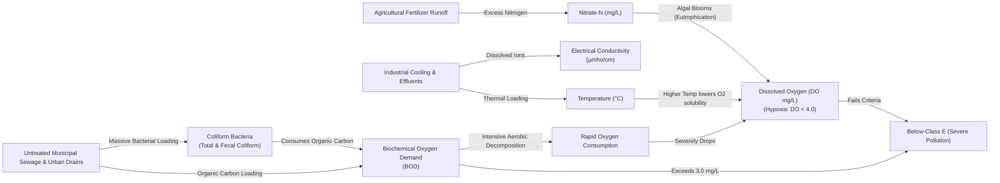
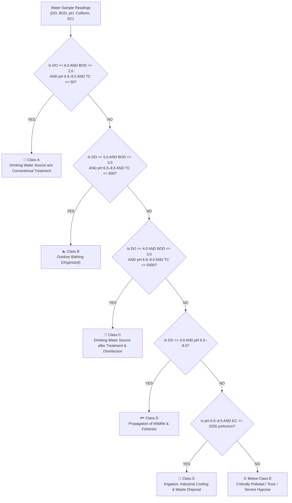

# 🧠 River Water Quality Analytics — Complete Mind Graph & Architecture

This document contains the dedicated **Mind Graphs, Concept Trees, and Knowledge Flowcharts** for the entire River Water Quality Analytics System.

---

## 1. Master System Mind Graph (End-to-End Project Map)

```mermaid
flowchart TD
    ROOT(("🌊 River Water Quality<br/>Analytics System"))

    %% Branch 1: Data Ingestion
    ROOT --> B1["📂 1. Data Ingestion & Audit"]
    B1 --> B1_1["Raw CSV: 10,006 Rows, 22 Cols"]
    B1 --> B1_2["Encoding Fallback (UTF-8, Latin-1, CP1252)"]
    B1 --> B1_3["Audit: 362 Duplicates Detected"]
    B1 --> B1_4["Temporal Coverage: 2012–2023 (10 Years)"]
    B1 --> B1_5["Spatial Coverage: 54 Raw State Labels"]

    %% Branch 2: Data Cleaning
    ROOT --> B2["🧹 2. Cleaning & Preprocessing"]
    B2 --> B2_1["Placeholder Tokens to NaN ('BDL', 'nil', '-')"]
    B2 --> B2_2["Number Defragmentation ('76-\n 00' ➔ 7600)"]
    B2 --> B2_3["Deduplication (10,006 ➔ 9,644 Records)"]
    B2 --> B2_4["State Harmonization (54 ➔ 30 Standardized)"]
    B2 --> B2_5["Safe Outlier Bounding (No Data Deleted)"]
    B2_5 --> B2_5a["pH: [0.0, 14.0]"]
    B2_5 --> B2_5b["Temp: [0.0, 50.0] °C"]
    B2_5 --> B2_5c["DO: [0.0, 25.0] mg/L"]

    %% Branch 3: Feature Engineering
    ROOT --> B3["⚙️ 3. Feature Engineering"]
    B3 --> B3_1["Paired Averages: (Min + Max) / 2"]
    B3 --> B3_2["Paired Ranges: |Max - Min|"]
    B3 --> B3_3["Microbial Log Scaling: log10(Coliform + 1)"]
    B3 --> B3_4["DO Saturation Deficit: max(0, 8.5 - DO)"]
    B3 --> B3_5["BOD-to-Nitrate Loading Ratio"]
    B3 --> B3_6["Output: 45 Total Engineered Columns"]

    %% Branch 4: Regulatory Assessment
    ROOT --> B4["🏛️ 4. Official Regulatory Assessment"]
    B4 --> B4_1["CPCB Designated Best Use Criteria"]
    B4_1 --> B4_1a["Class A: Drinking w/o Treatment (12.9%)"]
    B4_1 --> B4_1b["Class B: Outdoor Bathing (22.1%)"]
    B4_1 --> B4_1c["Class C: Drinking with Treatment (23.2%)"]
    B4_1 --> B4_1d["Class D: Wildlife & Fisheries (25.5%)"]
    B4_1 --> B4_1e["Class E: Irrigation / Industrial (7.5%)"]
    B4_1 --> B4_1f["Below-E: Severely Polluted / Hypoxic (8.8%)"]
    B4 --> B4_2["Weighted Arithmetic WQI (WAWQI)"]
    B4_2 --> B4_2a["BIS 10500 Standard Weighting"]
    B4_2 --> B4_2b["Continuous Score: 0 to 100+"]

    %% Branch 5: Machine Learning
    ROOT --> B5["🤖 5. Machine Learning (Zero-Leakage)"]
    B5 --> B5_1["Target Selection: BOD_Avg (mg/L)"]
    B5 --> B5_2["Data Leakage Safeguard"]
    B5_2 --> B5_2a["BOD Min, Max, Range strictly removed from X"]
    B5 --> B5_3["Temporal Split (Train <= 2020, Test 2021-2023)"]
    B5 --> B5_4["Scikit-Learn ColumnTransformer Pipeline"]
    B5 --> B5_5["Model Benchmark & Tuning"]
    B5_5 --> B5_5a["Linear & Ridge Regression (Baselines)"]
    B5_5 --> B5_5b["Decision Tree (Overfitted)"]
    B5_5 --> B5_5c["Gradient Boosting & XGBoost"]
    B5_5 --> B5_5d["🏆 Champion: Tuned Random Forest (RMSE 6.48, R² 0.515)"]

    %% Branch 6: Explainability
    ROOT --> B6["🔍 6. Explainable AI (XAI)"]
    B6 --> B6_1["SHAP (TreeExplainer) Beeswarm"]
    B6 --> B6_2["Coliforms (>45% Importance): Untreated Sewage"]
    B6 --> B6_3["DO Inverse Impact (r = -0.32): Microbial Hypoxia"]
    B6 --> B6_4["Residual Diagnostics: Homoscedastic & Normal"]

    %% Branch 7: Dashboard
    ROOT --> B7["🖥️ 7. Streamlit Web Portal (9 Modules)"]
    B7 --> B7_1["Overview & Cleaning Audit"]
    B7 --> B7_2["Interactive Analytics & Correlations"]
    B7 --> B7_3["Decadal Trends (2012–2023)"]
    B7 --> B7_4["State Rankings & Station Deep-Dive"]
    B7 --> B7_5["WQI & CPCB Regulatory Compliance"]
    B7 --> B7_6["Live Real-Time Prediction & Advisory"]
    B7 --> B7_7["Model Leaderboard & Diagnostics"]
    B7 --> B7_8["SHAP Explainability Visualizer"]
    B7 --> B7_9["Environmental Policy Recommendations"]
```

---

## 2. Water Quality Parameters Relationship Graph

This graph illustrates the **biochemical cause-and-effect relationships** among water quality parameters in the river ecosystem:

---

## 3. Regulatory Classification Decision Tree Mind Graph

How the system classifies river water according to **CPCB Designated Best Use**:

---

## 4. Machine Learning & Zero-Leakage Pipeline Architecture

```mermaid
flowchart LR
    subgraph INPUT["Feature Inputs (X)"]
        F1["Physical: Temp_Avg, Temp_Range, EC_Avg, EC_Range"]
        F2["Chemical: DO_Avg, DO_Range, pH_Avg, pH_Range, Nitrate_Avg, Nitrate_Range"]
        F3["Microbial: Log_Total_Coliform, Log_Fecal_Coliform"]
        F4["Context: State (One-Hot Encoded), Year"]
    end

    subgraph ISOLATION["Strict Leakage Isolation"]
        L1["⛔ EXCLUDED FROM X:<br/>BOD_Min, BOD_Max, BOD_Range, WQI, CPCB_Class"]
    end

    subgraph PREPROC["Preprocessing Pipeline"]
        P1["Numeric Transformer:<br/>SimpleImputer(median) ➔ StandardScaler()"]
        P2["Categorical Transformer:<br/>OneHotEncoder(handle_unknown='ignore')"]
    end

    subgraph MODELS["Candidate Benchmark Models"]
        M1["Linear Regression (Baseline)"]
        M2["Ridge Regression (alpha=10)"]
        M3["Decision Tree Regressor"]
        M4["Gradient Boosting Regressor"]
        M5["XGBoost (Tuned)"]
        M6["🏆 Random Forest (Tuned)"]
    end

    subgraph OUTPUT["Output & Diagnosis"]
        OUT1["Predicted BOD (mg/L)"]
        OUT2["CPCB Best Use Category"]
        OUT3["WAWQI Water Quality Score"]
        OUT4["Actionable Environmental Advisory"]
    end

    INPUT --> PREPROC
    PREPROC --> MODELS
    MODELS --> OUT1
    OUT1 --> OUT2 & OUT3 & OUT4
```

---

## 5. Summary of Mind Graph Concepts for Quick Viva Recall

| Mind Graph Branch | Core Concept | Key Metric / Result |
| :--- | :--- | :--- |
| **Data Cleaning** | Robust token parsing, duplicate removal, safe outlier capping | 10,006 ➔ 9,644 rows; 362 duplicates removed |
| **Feature Engineering** | Min/Max paired averages, ranges, log10 coliforms, DO deficit | 45 high-information features generated |
| **Regulatory Assessment** | CPCB Statutory Criteria & Weighted Arithmetic WQI | Class A (12.9%), Class B (22.1%), Below-E (8.8%) |
| **Machine Learning** | Temporal Prospective Split ($\le 2020$ train, $2021\text{--}2023$ test) | Zero target leakage maintained |
| **Champion Model** | Tuned Random Forest Ensemble (150 trees, max_depth 12) | **Test RMSE: 6.48 mg/L, Test MAE: 2.09 mg/L, $R^2$: 0.515** |
| **Explainable AI (XAI)** | Global SHAP Feature Impact Analysis | Total Coliform ($>45\%$ impact) = Untreated Sewage |
| **Interactive Dashboard** | Streamlit multi-page web application portal | 9 analytical and predictive modules deployed |
