# River Water Quality Analytics System — End-to-End Workflow Flowchart

Below is the complete architectural flowchart representing the end-to-end data science and machine learning pipeline, matching the project system workflow.

```mermaid
flowchart TD
    subgraph S1["1. Data Ingestion & Audit"]
        A1["Raw Dataset: RiverWaterQualityOverYears.csv<br/>(10,006 rows, 22 columns)"] --> A2["Data Understanding & Audit<br/>• Schema & Dtypes<br/>• Missing Values & Artifacts<br/>• Duplicate Detection (362 duplicates)<br/>• Temporal Span (2012–2023)<br/>• States (54 raw entities)"]
    end

    subgraph S2["2. Data Cleaning & Feature Engineering"]
        A2 --> B1["Data Cleaning & Preprocessing<br/>• Convert '-', 'BDL', 'nil' to NaN<br/>• Parse broken numbers ('76-\n 00')<br/>• Deduplicate exact rows (9,644 clean)<br/>• State Name Normalization (54 -> 30)<br/>• Safe Physical Outlier Capping"]
        B1 --> B2["Feature Engineering<br/>• Average: (Min + Max) / 2<br/>• Range: |Max - Min|<br/>• Log Transforms (Coliforms)<br/>• Nutrient & DO Ratios<br/>• Period Bins (45 features)"]
    end

    subgraph S3["3. Exploratory & Spatial Analytics"]
        B2 --> C1["Exploratory Data Analysis (EDA)<br/>• Histograms & KDE Distributions<br/>• Box Plots & Outlier Profiles<br/>• Pearson Correlation Matrix"]
        B2 --> C2["Temporal Trajectory Analysis<br/>• 2012–2023 Multi-Year Trends<br/>• 2012 vs. 2023 Direct Comparison<br/>• Improving vs Deteriorating Parameters"]
        B2 --> C3["State & Spatial Analytics<br/>• State-wise Median BOD Ranking<br/>• Top 20 Polluted River Hotspots<br/>• Station-Level Historical Tracking"]
    end

    subgraph S4["4. Regulatory Assessment"]
        C1 & C2 & C3 --> D1["Official Water Quality Assessment<br/>• CPCB Designated Best Use (Class A–E)<br/>• Weighted Arithmetic WQI (WAWQI)<br/>• Aligned with BIS 10500 Standards"]
    end

    subgraph S5["5. Machine Learning Pipeline (Zero Leakage)"]
        D1 --> E1["ML Problem Formulation<br/>• Target: BOD_Avg (mg/L)<br/>• Zero Leakage: Min/Max/Range BOD Removed<br/>• Temporal Split: <= 2020 Train, 2021-23 Test"]
        E1 --> E2["Candidate Model Training<br/>• Linear Regression (Baseline)<br/>• Ridge Regression<br/>• Decision Tree<br/>• Random Forest<br/>• Gradient Boosting<br/>• XGBoost"]
        E2 --> E3["Hyperparameter Tuning & CV<br/>• GridSearchCV on Top 2 Ensembles<br/>• 5-Fold Cross-Validation"]
        E3 --> E4["Champion Model Selection<br/>• Random Forest (Tuned)<br/>• Test RMSE: 6.48 mg/L<br/>• Test MAE: 2.09 mg/L<br/>• Test R²: 0.515"]
    end

    subgraph S6["6. Explainability & Diagnostics"]
        E4 --> F1["Model Diagnostics<br/>• Actual vs. Predicted Plots<br/>• Residual Error Homoscedasticity<br/>• Error Normality Verification"]
        E4 --> F2["Explainable AI (XAI)<br/>• Gini / Gain Feature Importance<br/>• SHAP TreeExplainer Summary<br/>• Microbiological & Chemical Drivers"]
    end

    subgraph S7["7. Deployment & Real-World Decision Support"]
        F1 & F2 --> G1["Interactive Streamlit Dashboard<br/>• Overview & Audit Portal<br/>• Real-Time Parameter Analytics<br/>• Decadal Trajectory Explorer<br/>• Spatial Hotspot Analysis<br/>• Interactive ML BOD Predictor<br/>• Regulatory CPCB Diagnosis"]
        G1 --> G2["Actionable Policy Recommendations<br/>• Decentralized STPs in Urban Hotspots<br/>• Real-Time Continuous Sensors<br/>• Pre-monsoon Environmental Flows"]
    end
```

